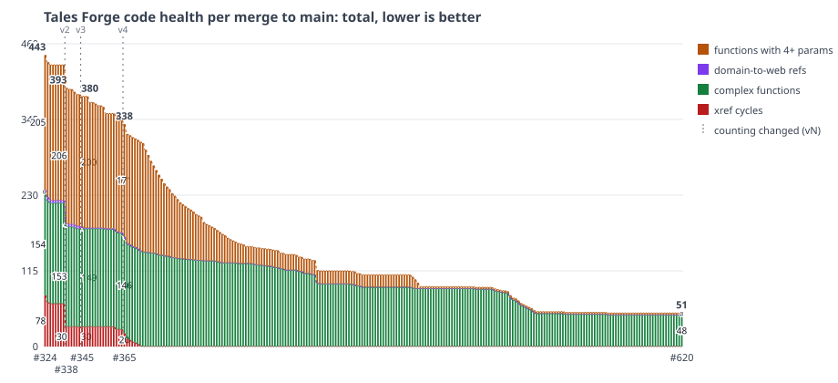

# Code health ratchet

The ratchet measures only code we write, which is `lib/`. It never
measures `deps/` or generated framework code, and framework-dictated shapes
are exempt: `@impl` callbacks are not counted for parameters, and the `~p`
edges into the router are not counted as cycles (#338), nor are Ecto
association edges between schemas (a parent's `has_many` and its child's
`belongs_to`), nor
application.ex starting the web endpoint, telemetry and presence as
domain -> web references (#345).

`mix health.check` (CI, and `mix precommit`) measures the code and
compares it with the same numbers at the base commit (`--base REF`,
default `origin/main`; CI passes the merge's first parent). It checks the
base out in a temporary git worktree and runs that commit's own
`mix health.check --out FILE` there. No baseline is committed: the base's
debt is the allow-list, so parallel PRs never conflict on it, and a PR
that pays debt down needs no extra file. The numbers:

- `cycles`: every `mix xref graph --format cycles` cycle (`all`, without
  `lib/ex_tales_forge_web/router.ex`) and every `--label compile-connected`
  cycle (with the router), with its size and member files. Every LiveView
  links to the router with `~p` and the router names every LiveView, so
  with the router every page would be in a cycle with every other. A cycle
  through an Ecto association edge does not count either
  (`Mix.Tasks.Health.Check.Schemas`). That's an edge from a file with
  `use Ecto.Schema` to a file whose modules it names only as `belongs_to`,
  `has_many`, `has_one` or `many_to_many` targets. A schema that also uses
  the other module in any other way (a struct, a call, an import) keeps the
  edge.
- `web_references`: each `lib/ex_tales_forge/` file that references a
  `lib/ex_tales_forge_web/` file in the xref graph, and the files it references.
  `lib/ex_tales_forge/application.ex` starting the endpoint, telemetry and
  presence does not count: Phoenix generates that supervision tree, and the
  app has to start them somewhere. `online.ex` -> `presence.ex` counts.
- `complex_functions`: each function over the Credo limits (cyclomatic
  complexity 9, ABC size 30) with its scores. A score is that function's
  ceiling; a missing score means the limit is its ceiling.
- `live_view_references`: each LiveView (`use TalesForgeWeb, :live_view` or
  `:public_live_view`) that references another LiveView in the xref graph,
  and the LiveViews it references (none on 2026-10-17). The router no
  longer shows pages that render each other; this list does.
- `counting`: the version of how the numbers are counted (2 since the
  router left the `all` cycles, 3 since application.ex's web children left
  the domain -> web references, 4 since Ecto association edges left the
  cycles).
- `wide_functions`: each `def`/`defp` head with 4 or more parameters
  (counted from the AST, `@impl` callbacks skipped), with its file and count.

It fails when the code is worse than the base: more cycles, a cycle that
is new or bigger than every base cycle, a new domain -> web reference, a
new LiveView -> LiveView reference, a new function over a limit, a score
above its ceiling, a new function with 4+ parameters, a listed one that
gained parameters, or a raised Credo limit. A rule that is new in the PR
has nothing at the base to compare with, so it starts from the PR's own
numbers. Until 2026-10-17 the numbers were committed in `baseline.json`
and every PR rewrote it; a base that still has that file is compared with
it. `mix health.check --out FILE` writes the numbers as JSON.

On top of never-worse, each PR must make the code it touches better (the
Kaizen rule in `docs/principles.md`, `Mix.Tasks.Health.Check.Files`). A
`lib/` file's score is the sum of the Credo ABC sizes of its functions.
Over the `lib/` files changed since the merge base, measured at the merge
base and in the working tree:

- net: the changed files that exist at the base must score at least 1
  lower in total. A deleted file scores 0 on the PR. A new file is left
  out: it only has to keep to the per-function limits above;
- cap: no file that exists at the base may score more than 10% above its
  base score. Split it instead.

The gate lists each file that got worse; the PR description must say why.
It cannot read the PR description, so that part is on the reviewer.

## History

`history.csv` has one row per merge to main since #324 (the ratchet): date,
PR, xref cycles, largest cycle, compile-connected cycles (count and largest),
domain -> web references, functions over the complexity limits,
functions with 4+ parameters and `counting` (blank is 1). A bar where
`counting` changes is marked "counting changed": the router left the `all`
cycles at that merge (65 → 30 on the same code), and application.ex's
web children left the domain -> web references at #345 (4 → 1), and the
Ecto association edges left the cycles at counting 4 (26 → 20 on the same
code), not refactors. Lower is
better. `mix health.snapshot` measures HEAD, puts its row in the CSV and
redraws `trend.svg`: one stacked bar per merge (xref cycles + complex
functions + domain -> web refs + functions with 4+ parameters, total on
top). Run it by hand after a merge to main when you want a new row, and
open a PR for the two history files (a docs-only PR skips the code checks).
The old `.github/workflows/health-snapshot.yml` workflow, which ran the
task after each merge and opened rolling PR #600, was deleted in hobby
mode (step 6); close #600 after that change lands. `--keep`, `--out` and
`--row` still work if you need to merge histories by hand. The first rows
are the merges that changed the then committed `baseline.json` (#324,
#325, #326), measured again at each merge commit. The 4+ parameter
counts up to #334 were measured on each merge commit's `lib/` too. A row
goes in merge order.

`lib/ex_tales_forge -> ExTalesForgeWeb` is measured with xref (real compile, export and
runtime references), not grep: module names in docs and strings do not count.
